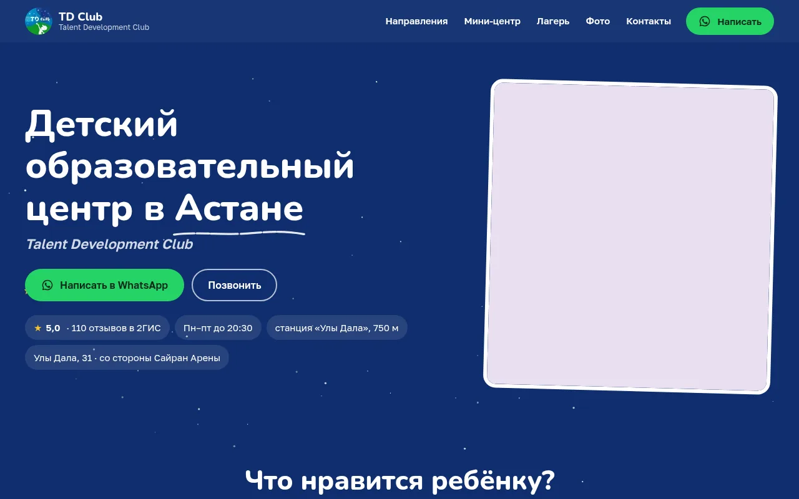

# TD Club — сайт детского центра

**Бизнес:** Детский образовательный центр TD Club, Астана.

## Задача
Одностраничный сайт центра: помочь родителю быстро подобрать занятие по возрасту и написать в WhatsApp.

## Что сделано
- Подбор занятий по возрасту и направлению (кнопки-чипы)
- Блоки: направления, раннее развитие, достижения, летний лагерь, фото, отзывы, «Впервые у нас»
- Контакты со статической картой OpenStreetMap и кнопкой маршрута в 2ГИС
- Кнопка WhatsApp, логотип и favicon

## Стек
Astro 5, TypeScript, Tailwind CSS 4, шрифты Nunito и Golos Text (Fontsource). Деплой — Cloudflare Workers (статические файлы, Wrangler).

## Демо
https://td-club.a-a-studio.workers.dev

## Примечание
В этом репозитории фотографии детей заменены одной нейтральной картинкой-заглушкой, поэтому вид отличается от живого сайта. Скриншот снят с этой версии.

---
Сделано с помощью AI-инструментов (Cursor, AI-агенты) под моим руководством.
